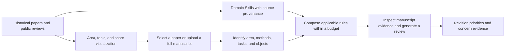
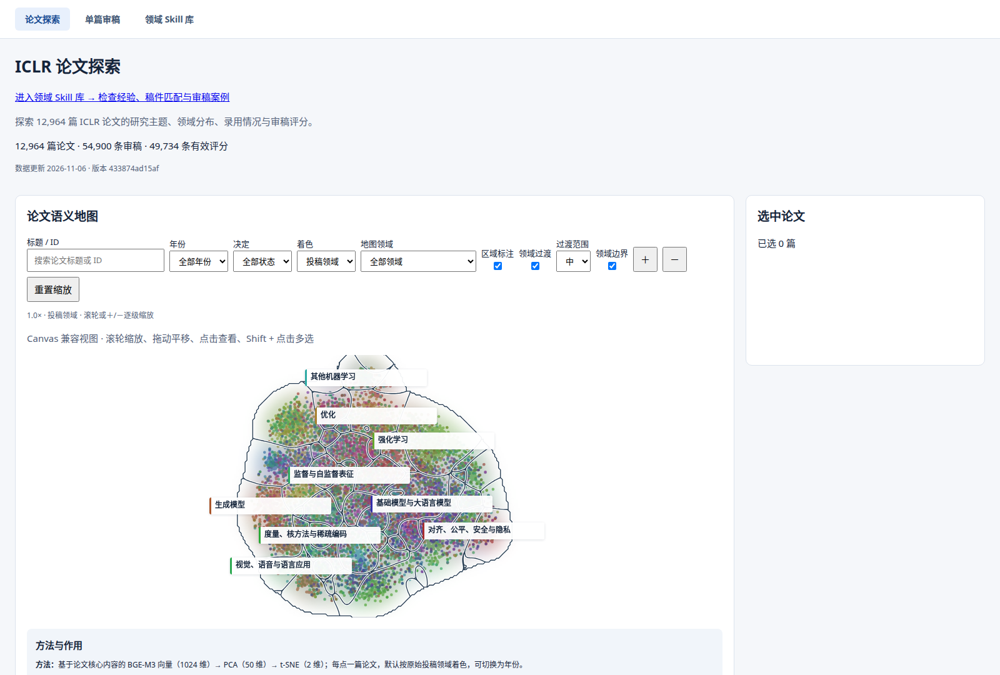
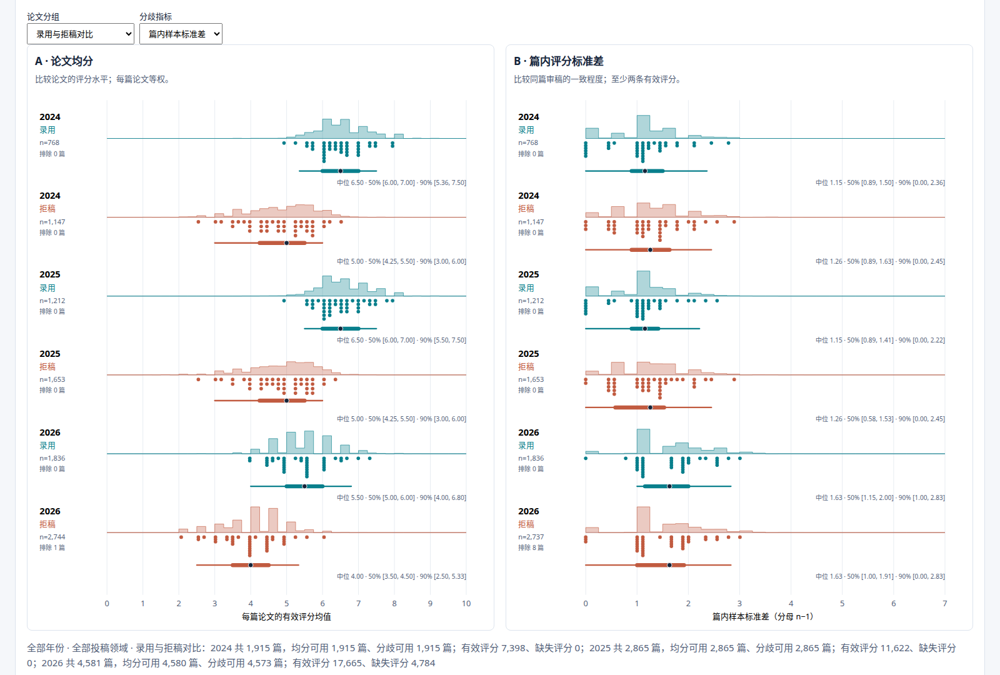
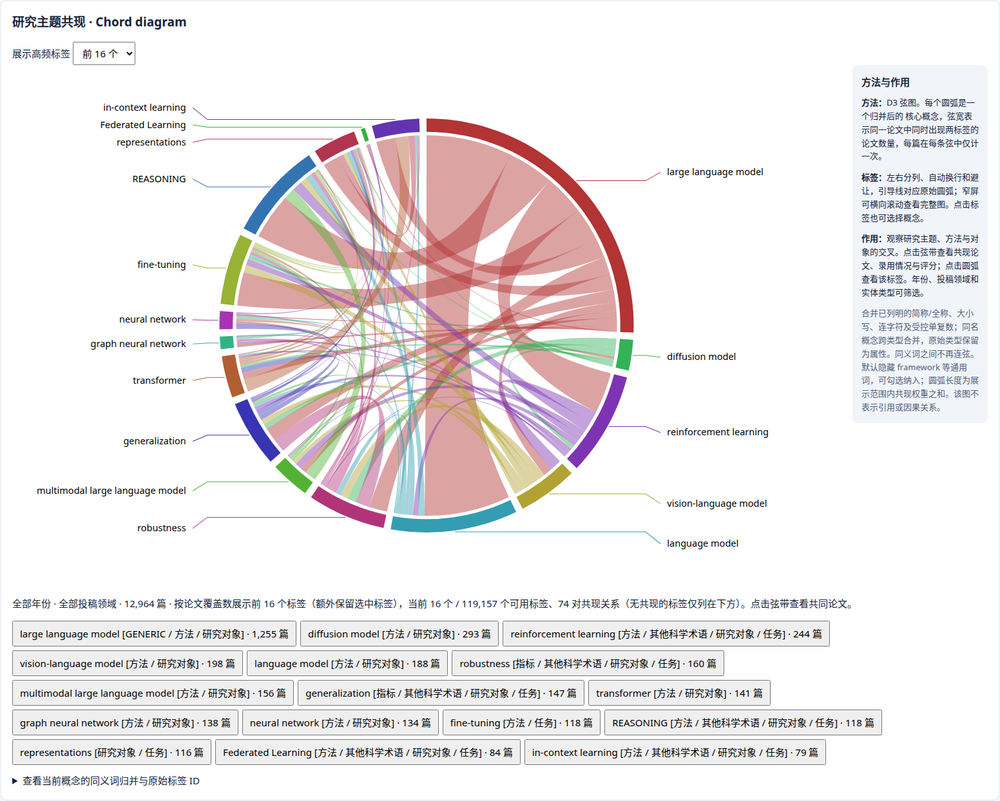
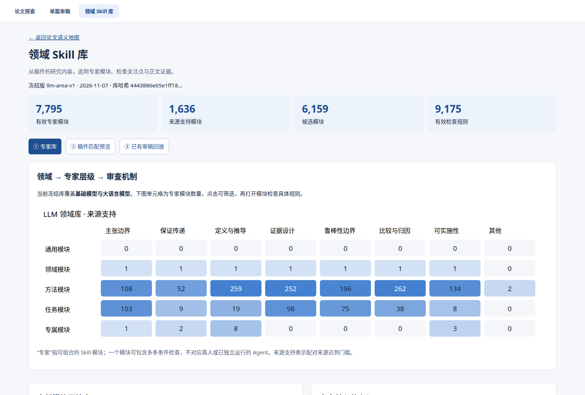
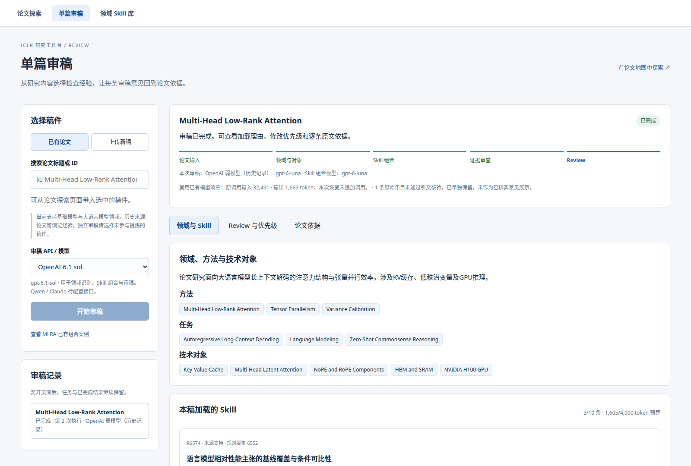
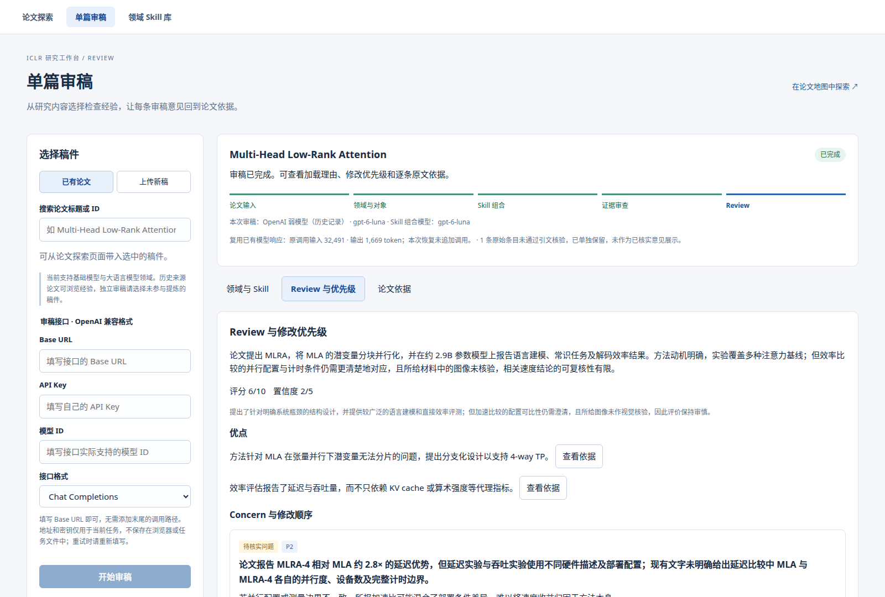
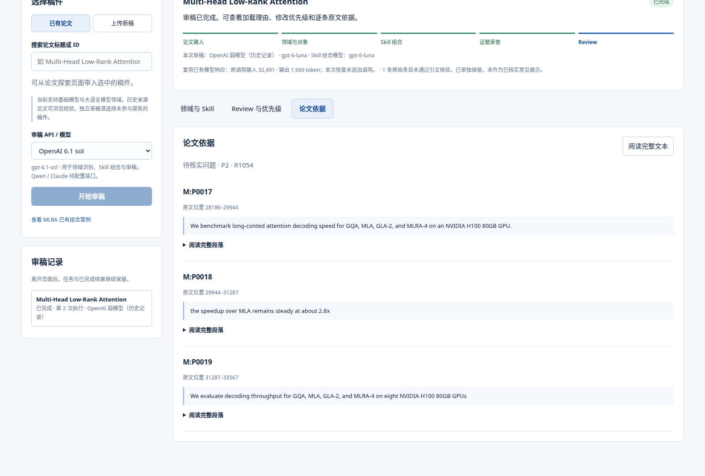

# ICLR Reviewer

English | [简体中文](README.zh-CN.md)

**From historical papers and review experience to manuscript reviews with traceable evidence.**

ICLR Reviewer is a research and visualization system for ICLR main-track papers. It explores research areas, paper topics, and review distributions; distills inspection rules from historical reviews paired with manuscript passages; and composes Skills for a new manuscript based on its methods, tasks, and technical objects. Reviews include revision priorities and links to supporting passages.

The website has three separate pages: **Paper Explorer, Manuscript Review, and Domain Skill Library**. The review workflow uses its own page alongside the existing visualization. The current automated review library covers foundation models and large language models.

> Updated: 2026-11-12. The website and one real manuscript review workflow are operational. Review accuracy, quality gains, and formal held-out evaluation remain on the research roadmap. Versioned demo downloads provide the paper map, frozen rules with paired sources, and completed review cases. A local installation supports map exploration, case replay, and review of uploaded manuscripts with a user-supplied model connection.

[Demo Downloads & Checksums](docs/DEMO_ASSETS.md) · [Deployment](docs/DEPLOYMENT.md) · [Methods and References](docs/METHODS.md) · [Progress and Roadmap](docs/STATUS.md) · [Repository Manifest](docs/REPOSITORY_MANIFEST.md) · [Technical Records](docs/technical_details/README.md) · [Figure Review Capabilities](docs/FIGURE_REVIEW.md)

## 1. Walkthrough



Start with the historical paper map to explore research concentrations, topic relationships, and review scores. Then inspect how historical experience becomes conditional rules with sources. Finally, review a new manuscript and see why each Skill was selected and which passages support each concern.

### Paper Explorer `/`

Each map point represents a paper. Filter by year, decision, submission area, or entity topic; zoom, select a paper, or select multiple papers. Area boundaries and representative topics support exploration at different scales. A selected paper can be opened in Manuscript Review.



The score panel compares paper means and within-paper reviewer disagreement by year. The chord diagram shows entity concepts appearing in the same papers, with links back to papers and source passages.



<details>
<summary>Show the concept co-occurrence diagram</summary>



</details>

### Domain Skill Library `/reviewers.html`

Browse frozen modules, their scope, inspection steps, failure mechanisms, and historical sources. Preview lexical matching locally and replay real trial reviews from earlier library versions. An “expert module” is a composable set of inspection rules.



### Manuscript Review `/review.html`

Open a paper from the map or upload DOC, DOCX, DOCS, PDF, Markdown, TXT, or LaTeX. Check the extracted manuscript, enter your model connection settings, and start the review. Separate views show the area and selected Skills, review and priorities, and manuscript evidence. Task state and failure records are preserved for retry.





Click a concern to inspect its exact source quotation, paragraph ID, and character offsets.



## 2. Data and Statistical Definitions

These counts come from a read-only database audit, sealed experiments, and the frozen release manifest. Each row describes its own scope.

| Scope | Current count | Description |
|---|---:|---|
| Public ICLR 2024–2026 main-track metadata | 38,890 papers | 2024: 7,404; 2025: 11,672; 2026: 19,814; title and abstract indexes in `raw/` |
| Database review records | 164,810 reviews | Review entities; 164,821 revision rows are counted separately. Initial/final score pairs require temporal checks |
| Available full-text indexes | 38,715 papers | Another 175 are missing. Text is kept in an external object store; the database records indexes and provenance |
| Paper understanding profiles | 38,807 papers | `paper_understanding_v1`: structured research problems, methods, and evidence; human quality assessment is pending |
| Sealed website sample | 12,964 papers / 54,900 reviews | Roughly one third of the corpus, stratified by year and area, retaining the original 500 seed papers |
| Papers with usable review statistics | Mean: 12,738 / disagreement: 12,725 | A mean requires at least 1 valid rating; standard deviation and range require at least 2 |
| Frozen domain library | 7,795 modules / 9,175 active rules | 1,851 source-supported and 7,324 candidate rules; currently the LLM area |

**Acceptance rate = accepted papers in the current filtered set ÷ all submissions in that set.** Withdrawn, desk-rejected, and unknown decisions are included in the denominator. The interface also shows category counts. Website statistics describe the displayed sample.

Each paper has equal weight in score and disagreement distributions. Within-paper sample standard deviation uses `n−1`; missing ratings stay missing. Years are shown separately. Central 50%/90% intervals describe observed distributions. The all-decision group overlaps the accepted and rejected groups.

## 3. Methods and Implementation

| Component | Current method | Relationship to prior work | Entry points |
|---|---|---|---|
| Data and full text | PostgreSQL 16 + pgvector; raw, core, semantic, twin, and operations layers; content addressing, text-first indexes, review revision backfill | Engineering data management and provenance tracking | [Database](database/README.md) |
| Parser comparison | Existing Markdown, Docling, and MinerU standard compared on the same 40 papers; visual conflict audit on 8 difficult pages | Direct use of parsing tools for development comparison; full-corpus fusion is future work | [Parser report](benchmarks/parser_comparison/standard_40_report.md) |
| Paper understanding | One-shot structured extraction, escalating to section-based hierarchical extraction when evidence or required fields are missing; quotation checks and resumable execution | Three project implementations; DocETL-style uses planning, decomposition, and aggregation | [50-paper comparison](benchmarks/paper_understanding/50_paper_report.md), [Pipeline](scripts/paper_understanding_pipeline.py) |
| Entities and area representations | Extract entity candidates and core problem/method/object from titles and abstracts; preserve source offsets and invalid candidates; BGE-M3 and Qwen embeddings for abstract and core-content views | TaxoAdapt and TopicGPT informed earlier comparisons; the sealed visualization uses entities and core content | [Sample protocol](docs/research/s4-entity-core-third/README.md), [Code](scripts/s4_entity_core_third.py) |
| Visualization | Core BGE-M3 → PCA(50) → t-SNE(2); Atlas/WebGPU and Canvas; kernel-density area boundaries; paper-deduplicated concept chords; R/ggdist distributions | Direct use of Embedding Atlas and ggdist; HINTs inspires overview-to-document-to-evidence navigation | [Web](web/README.md), [Exporter](web/export_s4.py) |
| Historical exchange diagnostics | 20 development cases; extract concerns and author actions at a temporal cutoff, then replay later messages; unobserved responses remain unknown | Prompt-based adaptation of RbtAct action analysis and evidence-constrained response planning | [Protocol](benchmarks/s5_trajectory/README.md), [Code](scripts/s5_fused20.py) |
| Domain Skill distillation | Atomic observations → rule merging/refinement → modules by mechanism/object → bounded recovery → source/hash audit → freeze | AutoManual-style manual construction, ACE-style incremental maintenance, and ReviewGrounder-style grounding | [Release record](docs/technical_details/S6_llm_area_library_release.md), [Freezer](scripts/freeze_llm_area_library.py) |
| Manuscript-specific composition | Identify area/method/task/object from full text; retrieve 24 candidates with character TF-IDF; assess each candidate; load at most 10 rules and 4,000 proxy tokens | Project implementation of budgeted selection; source-supported rules are the default | [Protocol](docs/technical_details/S6_manuscript_skill_composition.md), [Code](scripts/compose_manuscript_skills.py) |
| Web manuscript review | One composed review; separate supported defects, issues needing verification, and suggestions; attach evidence; serialize tasks and recover failures | Rubric-guided, evidence-grounded review | [Review runner](scripts/review_composed_manuscript.py), [Web integration](docs/technical_details/Web_single_paper_review.md) |

Paper titles, publication venues, adopted mechanisms, and experiment results are documented in **[Methods and References](docs/METHODS.md)**. Human assessment of rule quality is part of the roadmap.

## 4. Current Progress

- **Data and understanding:** main-track metadata is imported; full-text indexes and 38,807 profiles are available; historical review revisions continue to be backfilled.
- **Area visualization:** entity/core-content extraction for 12,964 papers and 51,856 embedding records are sealed. The map, chords, acceptance statistics, score/disagreement views, and evidence lookup are operational.
- **Domain library:** `llm-area-v1` is frozen with 0 pending queue items; 81 unresolved and 3 needs-evidence items are retained separately.
- **Composition and review:** MLRA completed a real composition and review using 3 rules and 1,605 proxy tokens, with selection reasons, historical sources, and concern-to-passage navigation. This case verifies the engineering workflow.
- **Website:** three topic pages, shared authentication, Word/PDF extraction, persistent tasks, retry, and HTTPS LAN access are integrated. Versioned portable data, rules/provenance and case packages support fresh local deployment.

For website reviews, enter your own **Base URL, API Key, and exact model ID**, then choose **Chat Completions** or **Responses**. Connection fields start empty and are supplied for the current task.

**Addresses and keys stay out of browser storage and task files.**

## 5. Roadmap

| Priority | Work | Completion criteria |
|---|---|---|
| 1 | Complete the remaining literature | Process the remaining two thirds of the 2024–2026 manuscripts |
| 2 | Multiple reviewers, AC synthesis, and online rebuttals | Define incremental value, cost, and evaluation, then integrate independent opinions, disagreement synthesis, and author responses |
| 3 | Visualize reviews and Skill usage | Show manuscript domains, selected Skill combinations, and the evidence behind review concerns |

More to come…

## 6. Local Deployment

**Linux + Python 3.11+ + Node 20.19+ or 22.12+.** The installer downloads and verifies the [versioned demo packages](docs/DEMO_ASSETS.md). The demo map, historical replays, and uploaded-manuscript reviews run without PostgreSQL, GPU models, R, or the original research directories.

```bash
git clone --single-branch --branch main https://github.com/Haoran-98/ICLR-reviewer.git
cd ICLR-reviewer
./scripts/install_website.sh
.venv/bin/python scripts/init_web_account.py --username root
./scripts/run_website.sh
```

Open **http://127.0.0.1:5174/** and log in with the password you just set. The account command prompts twice and stores a local password hash. Ubuntu/Debian users install `python3-venv` before running the installer; PDF/DOC extraction additionally uses `poppler-utils` and `libreoffice-writer`.

1. Explore the map and the Domain Skill Library, including its five historical replays.
2. On Manuscript Review, click the example button to replay the completed MLRA Review and inspect concern evidence.
3. Select the packaged MLRA paper or upload a full manuscript, enter your **Base URL / API Key / model ID / protocol**, and start a new review. Other map papers require an uploaded full manuscript or your own database.

`ICLR_DATA_DIR` changes the data location; `ICLR_RELEASE_DIR`, `ICLR_CASES_DIR`, and `ICLR_REVIEW_RUNS` override individual paths. Set the same variables during installation and startup. Imported cases stay read-only, while new tasks keep their state and support retry. See [the clean-deployment verification record](docs/DEPLOYMENT_VERIFICATION.md) for tested coverage.

For LAN access, create a certificate with `python3 web/setup_lan.py --ip <SERVER_IP>`, build the website, and run `npm --prefix web run lan`. Port 5173 redirects to HTTPS on 8443; clients trust the local CA. On an existing server, `./scripts/start_website.sh` and `./scripts/stop_website.sh` control its installed systemd unit.

See **[DEPLOYMENT.md](docs/DEPLOYMENT.md)** for prerequisites, offline downloads, path configuration, account initialization, optional database/R setup, and troubleshooting.

## 7. Repository Layout

```text
web/                    Three pages, exporters, review API, authentication, file extraction, browser checks
database/               Schema, migrations, setup, ingestion, and revision backfill
scripts/                Profiles, entities, Skill distillation/freezing/composition, reviews, and tests
benchmarks/             Method comparisons, development protocols, and summaries
skills/                 General review and evidence-grounding/distillation protocols
agents/                 Historical multi-role designs and configurations
raw/                    Public title/abstract and area metadata
docs/                   Methods, status, deployment, research records, and screenshots
automation/, twin_smoke/ Historical scheduled summaries and small-sample tools
```
