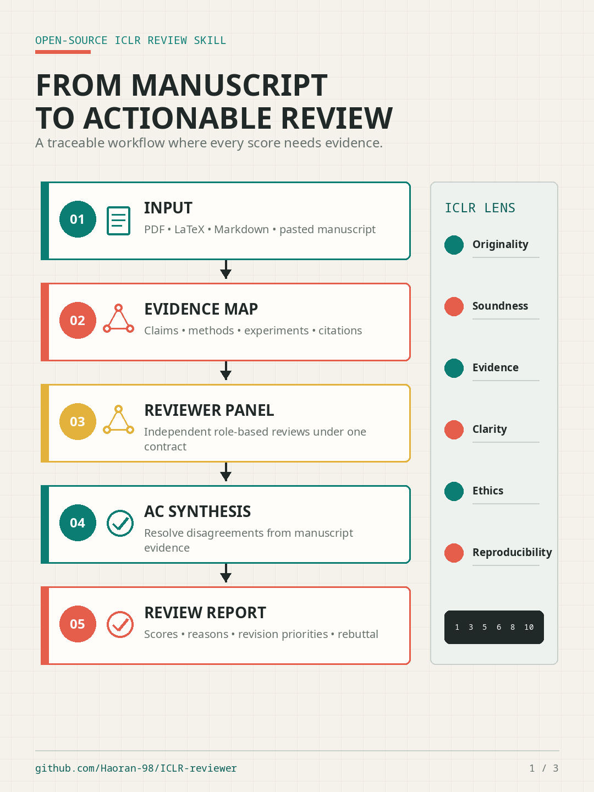
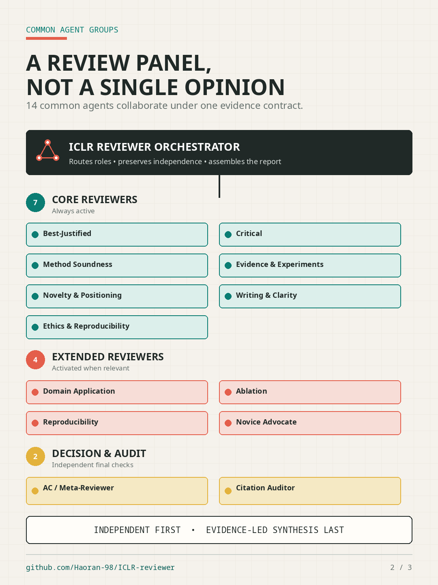
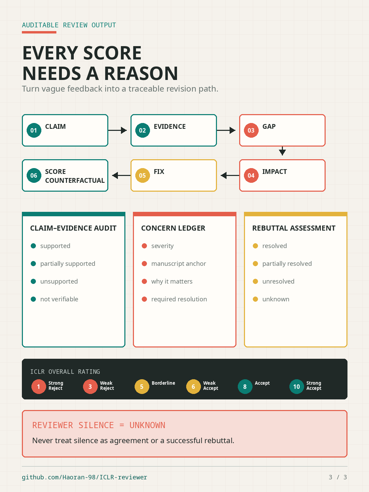

# ICLR Reviewer

[English](README.md)

<!-- DAILY_ACTIVITY:START -->
## 最近 3 天新增

<details open>
<summary>2026-08-12 - 新分析 20 篇论文，新增 0 个通用 Agent</summary>

| 年份 | 论文 | 主题 | 研究标签 |
|---:|---|---|---|
| 2024 | [Beyond Imitation: Leveraging Fine-grained Quality Signals for Alignment](https://openreview.net/forum?id=LNLjU5C5dK) | representation learning for computer vision, audio, language, and other modalities | LLM alignment, fine-grained supervision, supervised fine-tuning |
| 2024 | [3D Dense Captioning beyond Nouns: A Middleware for Autonomous Driving](https://openreview.net/forum?id=8T7m27VC3S) | datasets and benchmarks | autonomous driving, 3D dense captioning, multimodal representation |
| 2024 | [Understanding and addressing spurious correlation via Neural Tangent Kernels: A spectral bias perspective](https://openreview.net/forum?id=89AOrk05uy) | general machine learning (i.e., none of the above) | spurious correlations, neural tangent kernel, spectral bias |
| 2024 | [ReFACT: Updating Text-to-Image Models by Editing the Text Encoder](https://openreview.net/forum?id=u2as4lHoyl) | generative models | text-to-image generation, diffusion models, knowledge editing |
| 2025 | [Investigating Memorization in Video Diffusion Models](https://openreview.net/forum?id=RFZV2tOWYN) | alignment, fairness, safety, privacy, and societal considerations | video diffusion models, memorization, copyright |
| 2025 | [GuardAgent: Safeguard LLM Agent by a Guard Agent via Knowledge-Enabled Reasoning](https://openreview.net/forum?id=YixNDE12wm) | foundation or frontier models, including LLMs | LLM agents, agent safety, guardrails |
| 2025 | [Dissecting Bit-Level Scaling Laws in Quantizing Vision Generative Models](https://openreview.net/forum?id=7X2BFPl18T) | other topics in machine learning (i.e., none of the above) | quantization, vision generative models, bit-level scaling laws |
| 2025 | [JudgeBench: A Benchmark for Evaluating LLM-Based Judges](https://openreview.net/forum?id=G0dksFayVq) | datasets and benchmarks | LLM judges, benchmark, meta-evaluation |
| 2025 | [Noise Prompt Learning: Learning the Winning Tickets for Diffusion Sampling](https://openreview.net/forum?id=qIJenSdGbW) | generative models | text-to-image generation, diffusion models, noise optimization |
| 2025 | [Does Instruction Tuning Reduce Diversity? A Case Study Using Code Generation](https://openreview.net/forum?id=hMEHnLJyrU) | interpretability and explainable AI | LLM diversity, instruction tuning, preference tuning |
| 2026 | [Learning Across the Noise Spectrum: An Approach to Reinforcement Learning with Asynchronous Signals](https://openreview.net/forum?id=Id1YBclGbz) | reinforcement learning | reinforcement learning, robotics, asynchronous sensing |
| 2026 | [FedGMR: Federated Learning with Gradual Model Restoration under Asynchrony and Model Heterogeneity](https://openreview.net/forum?id=KL1LNgg73s) | infrastructure, software libraries, hardware, systems, etc. | federated learning, asynchronous federated learning, model heterogeneity |
| 2026 | [Improving Block-Wise LLM Quantization by 4-bit Block-Wise Optimal Float (BOF4): Analysis and Variations](https://openreview.net/forum?id=VpZ8YYdBmT) | foundation or frontier models, including LLMs | LLM quantization, 4-bit quantization, block-wise quantization |
| 2026 | [Strongly Convex Sets in Riemannian Manifolds](https://openreview.net/forum?id=4sDszSYKP6) | optimization | Riemannian optimization, Riemannian manifolds, strongly convex sets |
| 2026 | [It’s Not You, It’s Clipping: A Soft Trust-Region via Probability Smoothing for LLM RL](https://openreview.net/forum?id=1spOYCVPPg) | reinforcement learning | reinforcement learning, LLM alignment, PPO |
| 2026 | [Change of Thought: Adaptive Test-Time Computation](https://openreview.net/forum?id=86PhVA7veh) | unsupervised, self-supervised, semi-supervised, and supervised representation learning | adaptive computation, test-time computation, fixed-point iteration |
| 2026 | [DataS3: Dataset Subset Selection for Specialization](https://openreview.net/forum?id=KSdpxppcIm) | datasets and benchmarks | dataset subset selection, deployment specialization, dataset curation |
| 2026 | [Exposing Mixture and Annotating Confusion for Active Universal Test-Time Adaptation](https://openreview.net/forum?id=89gxHJkCXk) | transfer learning, meta learning, and lifelong learning | test-time adaptation, universal test-time adaptation, active learning |
| 2026 | [Bridging Bag-Level and Instance-Level Uncertainty with Conformalizable MIL](https://openreview.net/forum?id=PBmV8bOIsi) | probabilistic methods (Bayesian methods, variational inference, sampling, UQ, etc.) | conformal prediction, multiple instance learning, instance-level uncertainty |
| 2026 | [Spectrum Tuning: Post-Training for Distributional Coverage and In-Context Steerability](https://openreview.net/forum?id=ulvp7cbZeU) | alignment, fairness, safety, privacy, and societal considerations | post-training, distributional modeling, in-context steerability |

</details>

<details>
<summary>2026-08-11 - 新分析 19 篇论文，新增 0 个通用 Agent</summary>

| 年份 | 论文 | 主题 | 研究标签 |
|---:|---|---|---|
| 2024 | [TransNeXt: Aggregating Diverse Attentions in One Vision Model](https://openreview.net/forum?id=yMwJiJoadt) | representation learning for computer vision, audio, language, and other modalities | computer vision, vision transformers, attention mechanisms |
| 2024 | [USB-NeRF: Unrolling Shutter Bundle Adjusted Neural Radiance Fields](https://openreview.net/forum?id=igfDXfMvm5) | representation learning for computer vision, audio, language, and other modalities | Neural Radiance Fields, rolling shutter imaging, bundle adjustment |
| 2024 | [Agent-Centric State Discovery for Finite-Memory POMDPs](https://openreview.net/forum?id=67t4ikhlvP) | reinforcement learning | reinforcement learning, POMDPs, finite-memory POMDPs |
| 2025 | [Geometry-Aware Approaches for Balancing Performance and Theoretical Guarantees in Linear Bandits](https://openreview.net/forum?id=Oeb0I3JcVc) | other topics in machine learning (i.e., none of the above) | linear bandits, stochastic decision making, Thompson sampling |
| 2025 | [Heterogeneous Federated Learning: A Dual Matching Dataset Distillation Approach](https://openreview.net/forum?id=In0phMs7BK) | alignment, fairness, safety, privacy, and societal considerations | federated learning, dataset distillation, heterogeneous data |
| 2025 | [Learning Monotonic Attention in Transducer for Streaming Generation](https://openreview.net/forum?id=pbJMPo4HwR) | applications to computer vision, audio, language, and other modalities | streaming generation, transducer models, monotonic attention |
| 2025 | [On Pre-training of Multimodal Language Models Customized for Chart Understanding](https://openreview.net/forum?id=94LyPGDi0Y) | applications to computer vision, audio, language, and other modalities | multimodal language models, chart understanding, visual instruction tuning |
| 2025 | [Coreset Selection via Reducible Loss in Continual Learning](https://openreview.net/forum?id=mAztx8QO3B) | transfer learning, meta learning, and lifelong learning | continual learning, coreset selection, reducible loss |
| 2025 | [Improved Diffusion-based Generative Model with Better Adversarial Robustness](https://openreview.net/forum?id=1DVgysiIt7) | generative models | generative models, diffusion probabilistic models, consistency models |
| 2026 | [AudioMoG: Guiding Audio Generation with Mixture-of-Guidance](https://openreview.net/forum?id=LElJH6EYBq) | applications to computer vision, audio, language, and other modalities | audio generation, cross-modal generation, text-to-audio generation |
| 2026 | [CC-Learn: Cohort-Based Consistency Learning](https://openreview.net/forum?id=ppIkPCrTe6) | foundation or frontier models, including LLMs | large language models, reasoning consistency, reinforcement learning |
| 2026 | [ComformalMOS: Uncertainty-Aware MOS Prediction with Conformal Intervals and Ordinal Modeling](https://openreview.net/forum?id=3y5JUNuhHP) | probabilistic methods (Bayesian methods, variational inference, sampling, UQ, etc.) | - |
| 2026 | [BTC-LLM: Efficient Sub-1-Bit LLM Quantization via Learnable Transformation and Binary Codebook](https://openreview.net/forum?id=yBDBCpEzsO) | foundation or frontier models, including LLMs | large language models, model compression, binary quantization |
| 2026 | [Toward Stable Representations of Physical Systems](https://openreview.net/forum?id=ZAz5acC6cJ) | generative models | generative models, physical systems, dynamical systems |
| 2026 | [Flow-Guided Neural Operator For Self- Supervised Learning On Time Series Data](https://openreview.net/forum?id=D4CH3hCNdb) | unsupervised, self-supervised, semi-supervised, and supervised representation learning | self-supervised learning, time series representation learning, flow matching |
| 2026 | [AVSU-Bench and VSpeech-R1: A Dataset and MLLM for Audio-Visual Speech Understanding](https://openreview.net/forum?id=M9jciGcJpC) | datasets and benchmarks | audio-visual speech understanding, multimodal language models, speech recognition |
| 2026 | [Learning to Refine: Self-Refinement of Parallel Reasoning in LLMs](https://openreview.net/forum?id=nbhDNDDZMe) | generative models | large language models, test-time scaling, parallel reasoning |
| 2026 | [G-CUT3R: Guided 3D Reconstruction with Camera and Depth Prior Integration](https://openreview.net/forum?id=J7DiMqmIFl) | applications to computer vision, audio, language, and other modalities | 3D scene reconstruction, feed-forward reconstruction, geometric priors |
| 2026 | [In-Place Test-Time Training](https://openreview.net/forum?id=dTWfCLSoyl) | foundation or frontier models, including LLMs | test-time training, large language models, fast weights |

</details>

<details>
<summary>2026-08-10 - 新分析 20 篇论文，新增 0 个通用 Agent</summary>

| 年份 | 论文 | 主题 | 研究标签 |
|---:|---|---|---|
| 2024 | [Probabilistically Rewired Message-Passing Neural Networks](https://openreview.net/forum?id=Tj6Wcx7gVk) | learning on graphs and other geometries & topologies | graph neural networks, message passing, graph rewiring |
| 2024 | [LMEye: An Interactive Perception Network for Large Language Models](https://openreview.net/forum?id=c4QgNn9WeO) | representation learning for computer vision, audio, language, and other modalities | multimodal large language models, vision-language learning, interactive perception |
| 2024 | [3D Tissue Reconstruction and Generation for Single-Cell Spatial Transcriptomics using Neural Radiance Fields](https://openreview.net/forum?id=3DdCB6MRvu) | applications to physical sciences (physics, chemistry, biology, etc.) | single-cell spatial transcriptomics, 3D reconstruction, Neural Radiance Fields |
| 2024 | [LumiNet: The Bright Side of Perceptual Knowledge Distillation](https://openreview.net/forum?id=3ZWdgOvmAA) | transfer learning, meta learning, and lifelong learning | knowledge distillation, logit-based distillation, inter-class relations |
| 2025 | [Video Q-Former: Multimodal Large Language Model with Spatio-Temporal Querying Transformer Towards Video Understanding](https://openreview.net/forum?id=R6sIi9Kbxv) | foundation or frontier models, including LLMs | video-language models, multimodal large language models, video understanding |
| 2025 | [SATE: A Two-Stage Approach for Performance Prediction in Subpopulation Shift Scenarios](https://openreview.net/forum?id=BWYR9rfGOU) | transfer learning, meta learning, and lifelong learning | performance prediction, subpopulation shift, unsupervised accuracy estimation |
| 2025 | [Relaxing Representation Alignment with Knowledge Preservation for Multi-Modal Continual Learning](https://openreview.net/forum?id=CagdoUkvvl) | transfer learning, meta learning, and lifelong learning | multimodal continual learning, catastrophic forgetting, representation alignment |
| 2025 | [How language models extrapolate outside the training data: A Case study in Textualized Gridworld](https://openreview.net/forum?id=CfdPELywGN) | neurosymbolic & hybrid AI systems (physics-informed, logic & formal reasoning, etc.) | language models, neuro-symbolic AI, textual Gridworld |
| 2025 | [SimUSER: When Language Models Pretend to Be Believable Users in Recommender Systems](https://openreview.net/forum?id=rv9c1BqY0L) | applications to computer vision, audio, language, and other modalities | recommender systems, recommender-system evaluation, user simulation |
| 2025 | [Adaptive Priors from Learning Trajectories for Function-Space Bayesian Neural Networks](https://openreview.net/forum?id=Pdh1yMqwev) | probabilistic methods (Bayesian methods, variational inference, sampling, UQ, etc.) | Bayesian neural networks, function-space variational inference, uncertainty estimation |
| 2026 | [Modality-Balanced Decoupling Alignment for Text-Video Retrieval](https://openreview.net/forum?id=POTch0RnWL) | applications to computer vision, audio, language, and other modalities | domain:text-video retrieval, domain:video understanding, method:cross-modal embedding alignment |
| 2026 | [BioX-Bridge: Model Bridging for Unsupervised Cross-Modal Knowledge Transfer across Biosignals](https://openreview.net/forum?id=1448q0s3zZ) | applications to physical sciences (physics, chemistry, biology, etc.) | biosignal AI, health monitoring, cross-modal transfer |
| 2026 | [Sparse Imagination for Efficient Visual World Model Planning](https://openreview.net/forum?id=faxcxKINBC) | applications to robotics, autonomy, planning | visual world models, robotics, visual planning |
| 2026 | [WAFER-QA: Evaluating Vulnerabilities of Agentic Workflows with Agent-as-Judge](https://openreview.net/forum?id=V9fU8Pw9qr) | datasets and benchmarks | agentic workflows, agent-as-a-judge, LLM robustness |
| 2026 | [KAN or MLP? Point Cloud Shows the Way Forward](https://openreview.net/forum?id=1x0eJ8uUx6) | applications to computer vision, audio, language, and other modalities | point cloud analysis, Kolmogorov-Arnold networks, KAN |
| 2026 | [Generalization Error Bound via Embedding Dimension and Network Lipschitz Constant](https://openreview.net/forum?id=a7n5ZrsD2U) | learning theory | learning theory, generalization bounds, representation learning |
| 2026 | [Formal Mechanistic Interpretability: Automated Circuit Discovery with Provable Guarantees](https://openreview.net/forum?id=Timsb74vIY) | interpretability and explainable AI | mechanistic interpretability, circuit discovery, formal verification |
| 2026 | [Lang-PINN: From Language to Physics-Informed Neural Networks via a Multi-Agent Framework](https://openreview.net/forum?id=ONEyVpgK34) | applications to physical sciences (physics, chemistry, biology, etc.) | AI for science, physics-informed neural networks, partial differential equations |
| 2026 | [Jailbreaking the Matrix: Nullspace Steering for Controlled Model Subversion](https://openreview.net/forum?id=qlf6y1A4Zu) | alignment, fairness, safety, privacy, and societal considerations | LLM safety, jailbreak attacks, white-box model attacks |
| 2026 | [Adaptive Preconditioners Trigger Loss Spikes in Adam](https://openreview.net/forum?id=dwx3rjWGju) | learning theory | deep learning optimization, Adam, adaptive preconditioning |

</details>
<!-- DAILY_ACTIVITY:END -->

---

<!-- WEEKLY_ACTIVITY:START -->
## 上周新增

| 周期 | 新分析论文 | 年份分布 | 高频研究标签 |
|---|---:|---|---|
| 2026-08-03 - 2026-08-09 | 58 | 2024: 10, 2025: 18, 2026: 30 | large language models (7), vision-language models (5), reinforcement learning (5), datasets and benchmarks (2), LLM agents (2), multi-agent systems (2), diffusion models (2), medical anomaly detection (1), medical imaging (1), benchmark datasets (1) |
<!-- WEEKLY_ACTIVITY:END -->

---

## 项目介绍

ICLR Reviewer 将 ICLR 公开论文、审稿意见、作者回复和最终决定整理成可复现的数据与多 Agent 审稿基础设施，用于研究 ICLR 的评分逻辑、审稿趋势、rebuttal 成败、录用因素，以及构建基于证据的审稿人和投稿人模拟。

即使目标是其他会议，项目也统一使用 ICLR 视角审视研究：创新性、技术可靠性、实验与证据、清晰度、可复现性、伦理风险和领域匹配。目标不是模仿可识别的真实个人，而是从公开历史证据中构建可审计的审稿行为模型，并保留不确定性与反事实假设。

## 作为 Codex Skill 使用

克隆仓库并安装内置 Skill：

```bash
git clone https://github.com/Haoran-98/ICLR-reviewer.git
cd ICLR-reviewer
mkdir -p "$HOME/.codex/skills"
ln -s "$PWD/skills/iclr-reviewer" "$HOME/.codex/skills/iclr-reviewer"
```

重启 Codex 后，可以直接审查 PDF、LaTeX 项目、Markdown 稿件或粘贴的论文内容：

```text
$iclr-reviewer 审查 /path/to/paper.pdf，并解释每个评分和修改优先级。
```

对于不能自动发现 Codex Skill 的 Agent：

```text
读取 skills/iclr-reviewer/SKILL.md，并用它审查 /path/to/paper.pdf。
```

输出包含各审稿角色的独立评分、基于稿件证据的优点与问题、claim-evidence 审计、AC 决策、置信度、修改优先级，以及每项修改可能影响评分的原因。提供审稿意见和作者回复后，还会判断哪些问题已经解决，以及为什么应该或不应该提分。

## 图示说明

### 从稿件到可执行审稿报告

系统首先建立论文的证据地图，再运行相互独立的角色审稿，由 AC 根据稿件证据解决冲突，最终输出带原因的评分和修改优先级。

<p align="center">
  
</p>

### 通用 Agent 分组

14 个通用 Agent 覆盖审稿编排、核心科学评审、按需扩展评审、元决策和独立引用审计。领域角色只补充核心面板，不替代核心审稿流程。

<p align="center">
  
</p>

### 证据、原因与反事实

每个重要问题都沿着“论断、证据、缺口、影响、修复、可能评分变化”的链路进行记录。审稿人沉默保持为 `unknown`，不会被解释为同意。

<p align="center">
  
</p>

## 仓库内容

- ICLR 2024-2026 主会论文的题目、摘要和主题目录
- 用于确定性过滤、提取、批处理、校验和审稿画像生成的 Python 脚本
- 通用审稿 Agent 分组及其协作规则
- 可安装的 `$iclr-reviewer` Codex Skill

仓库不包含论文 PDF、Workshop 记录、认证信息、API 请求/响应日志或本机路径。

## 分组审稿 Agent

公开配置位于 [`agents/reviewer_groups.json`](agents/reviewer_groups.json)：

- 核心审稿组：正向论证、严格批判、方法可靠性、实验与证据、创新定位、写作、伦理与复现
- 扩展审稿组：领域应用、消融证据、复现和非专家可理解性
- 决策与审计组：AC / Meta-Reviewer 和独立 Citation Auditor

通用面板始终运行，并可增加最多三个匹配的领域专科角色。AC 必须基于稿件证据解决冲突，不能用平均分掩盖致命问题；引用审计独立于 AC。

### 现有 Agent 分组

<!-- AGENT_GROUPS:START -->
| 分组 | Agent | 作用 | 加入日期 |
|---|---|---|---|
| 编排 | `iclr_reviewer_orchestrator` (ICLR 审稿编排器) | 路由审稿组、保持独立评审，并生成基于证据的最终报告。 | 2026-07-26 |
| 核心审稿组 | `best_justified` (最强正向论证审稿人) | 基于稿件证据构建最充分的接收理由。 | 2026-07-26 |
| 核心审稿组 | `critical` (严格批判审稿人) | 寻找影响最大的未解决失败模式。 | 2026-07-26 |
| 核心审稿组 | `method_soundness` (方法可靠性审稿人) | 检查问题定义、假设、推导、算法和数据泄漏。 | 2026-07-26 |
| 核心审稿组 | `evidence_experiment` (实验与证据审稿人) | 审查基线、控制实验、指标、消融、统计和鲁棒性。 | 2026-07-26 |
| 核心审稿组 | `novelty_positioning` (创新与定位审稿人) | 根据最接近的相关工作检验真实贡献。 | 2026-07-26 |
| 核心审稿组 | `writing_clarity` (写作与清晰度审稿人) | 检查定义、逻辑结构、图表和可读性。 | 2026-07-26 |
| 核心审稿组 | `ethics_reproducibility` (伦理与复现审稿人) | 检查潜在伤害、数据权利、隐私、滥用、局限和复现性。 | 2026-07-26 |
| 扩展审稿组 | `domain_application` (领域应用审稿人) | 验证领域假设、实际效用和评测真实性。 | 2026-07-26 |
| 扩展审稿组 | `evidence_ablation` (消融审稿人) | 检验实验是否隔离了各组件的真实贡献。 | 2026-07-26 |
| 扩展审稿组 | `reproducibility` (复现审稿人) | 根据论文重建实现细节和实验流程。 | 2026-07-26 |
| 扩展审稿组 | `novice_advocate` (非专家可理解性审稿人) | 识别未解释的前置知识和难以理解的表达。 | 2026-07-26 |
| 决策与审计 | `ac_meta_reviewer` (AC / 元审稿人) | 根据证据解决评审冲突，不用平均分掩盖致命问题。 | 2026-07-26 |
| 决策与审计 | `citation_auditor` (引用审计员) | 在来源可用时独立核验引用存在性和论断支持关系。 | 2026-07-26 |
<!-- AGENT_GROUPS:END -->

### 最近 30 天新增 Agent

<!-- RECENT_AGENTS:START -->
| Agent | 分组 | 加入日期 |
|---|---|---|
| `writing_clarity` (写作与清晰度审稿人) | 核心审稿组 | 2026-07-26 |
| `reproducibility` (复现审稿人) | 扩展审稿组 | 2026-07-26 |
| `novice_advocate` (非专家可理解性审稿人) | 扩展审稿组 | 2026-07-26 |
| `novelty_positioning` (创新与定位审稿人) | 核心审稿组 | 2026-07-26 |
| `method_soundness` (方法可靠性审稿人) | 核心审稿组 | 2026-07-26 |
| `iclr_reviewer_orchestrator` (ICLR 审稿编排器) | 编排 | 2026-07-26 |
| `evidence_experiment` (实验与证据审稿人) | 核心审稿组 | 2026-07-26 |
| `evidence_ablation` (消融审稿人) | 扩展审稿组 | 2026-07-26 |
| `ethics_reproducibility` (伦理与复现审稿人) | 核心审稿组 | 2026-07-26 |
| `domain_application` (领域应用审稿人) | 扩展审稿组 | 2026-07-26 |
| `critical` (严格批判审稿人) | 核心审稿组 | 2026-07-26 |
| `citation_auditor` (引用审计员) | 决策与审计 | 2026-07-26 |
| `best_justified` (最强正向论证审稿人) | 核心审稿组 | 2026-07-26 |
| `ac_meta_reviewer` (AC / 元审稿人) | 决策与审计 | 2026-07-26 |
<!-- RECENT_AGENTS:END -->

## 题目与摘要目录

[`raw/`](raw/) 按年份和主会主题展示论文，并为每年提供轻量 JSONL gzip 索引。字段仅包含主题、题目、摘要、关键词、OpenReview ID 和页面链接，不包含 review、rebuttal、decision、作者或 PDF。

当前共收录 38,890 篇主会论文：

- 2024：7,404 篇
- 2025：11,672 篇
- 2026：19,814 篇

[`raw/manifest.json`](raw/manifest.json) 记录论文数、主题数、索引体积和 SHA-256。

## 时间协议

- 2024：训练
- 2025：校准
- 2026：完全留出测试

使用者可以为自己的实验定义其他划分，但项目的历史审稿孪生协议不会把 2026 证据加入画像生成提示词。

## 安装

```bash
python -m venv .venv
source .venv/bin/activate
pip install -r requirements.txt
```

运行本地提取流程：

```bash
export ICLR_REVIEWS_ROOT=/path/to/iclr_reviews
python twin_smoke/extract_priority_topics.py
python twin_smoke/prepare_priority_luna.py --batch-tokens 90000
```

API 运行器通过 `ICLR_AUTH_FILE` 读取兼容 OpenAI 的配置。不要提交认证文件、请求 payload 或模型原始响应。

## 研究边界

- 排除 Workshop 和 PDF 文件。
- reviewer silence 或语义不明确统一标记为 `unknown`。
- rebuttal 分析同时覆盖提分和未提分，并区分观察证据、因果假设与反事实条件。
- 匿名 reviewer ID 不用于推断真实身份。
- 历史模式只支持带不确定性的估计，不保证评分或录用结果。
