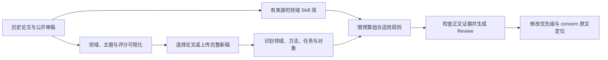

# ICLR Reviewer

[English](README.md) | 简体中文

**从历史论文与审稿经验，走向可解释、可定位原文的单篇审稿。**

ICLR Reviewer 是面向 ICLR 主会论文的研究与展示系统：用可视化探索研究领域、论文主题与审稿分布，从历史 Review 和正文中提炼有来源的检查规则，再按新稿的方法、任务和技术对象组合 Skill，输出 Review、修改优先级和正文依据。

当前版本包含三个独立主题页：**论文探索、单篇审稿、领域 Skill 库**。原有可视化保留，审稿流程通过独立子页接入。当前自动审稿规则覆盖基础模型与大语言模型领域。

> 更新：2026-11-12。网站与单篇真实运行闭环已完成；审稿准确性、质量提升及正式留出集评测仍待完成。版本化演示包提供论文地图、冻结规则与配对来源、已完成审稿案例。本地安装后可浏览地图、回放案例，并使用自填接口审查上传稿件。

[演示下载与校验和](docs/DEMO_ASSETS.md) · [部署说明](docs/DEPLOYMENT.md) · [方法与论文来源](docs/METHODS.md) · [进度与后续工作](docs/STATUS.md) · [上传内容清单](docs/REPOSITORY_MANIFEST.md) · [技术记录](docs/technical_details/README.md) · [论文图审查能力](docs/FIGURE_REVIEW.md)

## 1. 展示故事线



先用历史论文地图回答“研究集中在哪里、主题如何关联、审稿评分如何分布”；再展示审稿经验怎样形成带条件、带来源的规则；最后进入单篇新稿，解释“为什么加载这些 Skill、问题依据在哪里”。

### 论文探索 `/`

地图中的每个点代表一篇论文，支持年份、决定、投稿领域、实体主题筛选、缩放、点选和多选。领域边界与代表主题帮助逐层阅读，选中论文可进入单篇审稿。


评分区按年份比较论文均分与篇内分歧；弦图展示同一论文中的实体概念共现，并能回查相关论文和原文。


<details>
<summary>展开查看主题共现弦图</summary>


</details>

### 领域 Skill 库 `/reviewers.html`

浏览冻结的领域模块、适用范围、检查步骤、失效机制和历史来源；可进行本地词面匹配预览，并回放旧版本的真实试审记录。这里的“专家模块”是可组合的规则集合。


### 单篇审稿 `/review.html`

从地图带入论文，或上传 DOC、DOCX、DOCS、PDF、Markdown、TXT、LaTeX。检查提取的完整稿件，填写自己的接口配置后开始审稿。页面分别展示领域与 Skill、Review 与优先级、论文依据；任务状态和失败记录保留，可重试。


点击 concern，可查看逐字核验的原文引文、段落编号和字符位置。


## 2. 数据范围与统计口径

下列数字来自本次只读数据库核查、封存实验和冻结发布清单，分别对应不同范围。

| 数据范围 | 当前数量 | 含义 |
|---|---:|---|
| ICLR 2024–2026 主会公开题录 | 38,890 篇 | 2024：7,404；2025：11,672；2026：19,814；`raw/` 提供标题摘要索引 |
| 数据库审稿记录 | 164,810 条 | Review 实体数；164,821 行版本记录另计，初始/最终评分配对需按时间核查 |
| 可用正文索引 | 38,715 篇 | 另有 175 篇缺失；正文在外部对象存储中，数据库保存索引及出处 |
| 论文理解画像 | 38,807 篇 | `paper_understanding_v1`，结构化研究问题、方法和证据；人工质量验收待完成 |
| 网站封存样本 | 12,964 篇 / 54,900 条审稿 | 从主会题录按年份与领域分层取约三分之一，保留原 500 篇种子 |
| 网站可用论文级评分 | 均分 12,738 篇 / 分歧 12,725 篇 | 均分至少 1 条有效评分，标准差/极差至少 2 条 |
| 冻结领域库 | 7,795 个模块 / 9,175 条有效规则 | 1,851 条来源支持、7,324 条候选；当前为 LLM 领域 |

**中稿率 = 当前筛选集合中录用论文数 ÷ 当前筛选集合的总投稿量。** 撤稿、直接拒稿与未知状态也进入分母；界面同时展示各类数量。网站统计范围为当前展示样本。

均分和分歧按论文等权，篇内标准差使用分母 `n−1`，缺失评分不补零。评分分年份展示；中央 50%/90% 区间表示观测分布范围。全部决定组与录用/拒稿组存在重叠。

## 3. 各部分如何实现

| 部分 | 当前方法 | 论文/方法关系 | 主要入口 |
|---|---|---|---|
| 数据与正文 | PostgreSQL 16 + pgvector；原始、业务、语义、孪生、运维五层；内容寻址、文本优先索引、审稿版本回填 | 工程数据管理与来源追踪 | [database](database/README.md) |
| 解析器比较 | Existing Markdown、Docling、MinerU standard 的 40 篇同稿比较及 8 个困难页视觉冲突审计 | 直接使用解析工具作开发比较；三路融合是后续建议，未全量替换当前正文 | [解析报告](benchmarks/parser_comparison/standard_40_report.md) |
| 论文理解 | One-shot 结构化提取优先，证据缺失等情况升级为分节层次提取；引用核验与断点恢复 | 自研三路径比较；DocETL-style 采用计划、分解与汇总思路 | [50 篇比较](benchmarks/paper_understanding/50_paper_report.md)、[流水线](scripts/paper_understanding_pipeline.py) |
| 实体与领域表示 | 标题摘要抽取实体候选、核心问题/方法/对象；保留原文位置及无效候选；BGE-M3 与 Qwen 双模型、摘要/核心双视图向量 | TaxoAdapt、TopicGPT 用于早期分类方案比较；当前封存展示采用实体与核心内容方案 | [实体样本说明](docs/research/s4-entity-core-third/README.md)、[代码](scripts/s4_entity_core_third.py) |
| 可视化 | 核心 BGE-M3 向量 → PCA(50) → t-SNE(2)；Atlas/WebGPU 与 Canvas；核密度领域边界；独立论文共现弦图；R/ggdist 分布 | 直接使用 Embedding Atlas 与 ggdist；HINTs 提供“总览—文档—证据”交互启发 | [Web](web/README.md)、[导出](web/export_s4.py) |
| 历史交流诊断 | 20 篇开发案例，先按时间截断提取 concern/作者动作，再回放后续消息；未观察到回应保留 unknown | 借鉴 RbtAct 动作分析及证据约束响应规划，使用提示词实现 | [诊断协议](benchmarks/s5_trajectory/README.md)、[代码](scripts/s5_fused20.py) |
| 领域 Skill 提炼 | 原子观察 → 规则合并/修订 → 机制/对象分模块 → 有界恢复 → 来源与文件哈希审计 → 冻结 | 借鉴 AutoManual 的手册构建、ACE 的增量规则维护、ReviewGrounder 的证据约束 | [冻结记录](docs/technical_details/S6_llm_area_library_release.md)、[冻结器](scripts/freeze_llm_area_library.py) |
| 按新稿组合 | 完整稿件识别领域/方法/任务/对象；字符 TF-IDF 召回 24 条；模型逐条判断；最多 10 条、4,000 代理 token | 本项目实现的限预算选择流程；默认仅用来源支持规则 | [组合协议](docs/technical_details/S6_manuscript_skill_composition.md)、[代码](scripts/compose_manuscript_skills.py) |
| 单篇审稿 Web | 一次组合审查；输出缺陷/待核实问题/建议，绑定原文证据；任务串行与失败恢复 | 采用 rubric 与正文 grounding 思路，执行单次组合审查 | [审稿代码](scripts/review_composed_manuscript.py)、[Web 接入](docs/technical_details/Web_single_paper_review.md) |

论文题名、正式出处、采用程度与实验结果见 **[方法与论文来源](docs/METHODS.md)**；规则的人工质量评测列于后续计划。

## 4. 当前完成进度

- **数据与理解：** 全量主会题录入库，正文索引与 38,807 篇画像已建立；审稿历史版本继续回填。
- **领域可视化：** 12,964 篇实体/核心提取与 51,856 条双模型向量已封存；地图、弦图、录用统计、均分/分歧和证据回查可运行。
- **领域库：** `llm-area-v1` 已冻结，待处理队列为 0；81 条 unresolved、3 条 needs_evidence 单独保留。
- **新稿组合与审稿：** MLRA 已完成真实组合和 Review，3 条规则、1,605 代理 token；支持加载理由、历史来源和 concern 原文定位。单篇案例属于工程验证。
- **网站：** 三个主题页、统一登录、Word/PDF 提取、持久化任务、重试、HTTPS 局域网访问已接入。版本化网站数据、规则来源与案例包支持新机器本地部署。

网站审稿接口由使用者自行填写：**Base URL、API Key、准确模型 ID**，选择 **Chat Completions** 或 **Responses**。连接字段默认留空，由使用者为当前任务提供。

**地址和密钥不写入浏览器存储或任务文件。**

## 5. 后续要完成什么

| 优先顺序 | 工作 | 完成标准 |
|---|---|---|
| 1 | 补全剩余文献 | 24-26年稿件剩余三分之二待完成 |
| 2 | 多审稿人、AC 与在线 rebuttal | 先明确增量价值、成本和评测，再接入独立意见、分歧汇总及作者响应流程 |
| 3 | 审稿、skill的使用都将被可视化 | 可清晰观察稿件领域分布、使用的skill组合、审稿关切对应的证据所在…… |

等等……

## 6. 本地部署与运行

**环境：Linux、Python 3.11+、Node 20.19+ 或 22.12+。** 安装器会下载并校验[版本化演示包](docs/DEMO_ASSETS.md)。地图、历史回放及上传新稿审查使用随包资产即可运行；完整语料导出另需数据库与研究资产。

```bash
git clone --single-branch --branch main https://github.com/Haoran-98/ICLR-reviewer.git
cd ICLR-reviewer
./scripts/install_website.sh
.venv/bin/python scripts/init_web_account.py --username root
./scripts/run_website.sh
```

浏览器访问 **http://127.0.0.1:5174/**，使用刚设置的账号密码登录。账号命令两次提示输入密码，在本机保存密码哈希。Ubuntu/Debian 先安装 `python3-venv`；PDF/DOC 提取另需 `poppler-utils` 与 `libreoffice-writer`。

1. 浏览论文地图和领域 Skill 库，回放库中的 5 篇历史试审。
2. 在单篇审稿页加载案例，查看 MLRA 已完成的 Review，点击 concern 定位证据。
3. 选择随包 MLRA 稿件或上传完整新稿，填写 **Base URL / API Key / 模型 ID / 协议**，创建新审稿任务。地图中其他论文需上传全文，或接入自己的数据库。

`ICLR_DATA_DIR` 统一设置数据根目录；`ICLR_RELEASE_DIR`、`ICLR_CASES_DIR`、`ICLR_REVIEW_RUNS` 可分别覆盖路径。安装和启动使用同一组环境变量。导入案例只读回放；新任务保存状态，失败后可重试。[干净环境验证记录](docs/DEPLOYMENT_VERIFICATION.md)列明已测范围。

局域网使用 `python3 web/setup_lan.py --ip <服务器IP>` 创建本地证书，构建后运行 `npm --prefix web run lan`；5173 自动跳转至 HTTPS 8443，客户端信任本地 CA。已有服务器的 `./scripts/start_website.sh` / `./scripts/stop_website.sh` 用于控制已安装的 systemd 单元。

依赖、离线下载、路径配置、账号初始化、可选数据库与 R、常见问题见 **[DEPLOYMENT.md](docs/DEPLOYMENT.md)**。

## 7. 仓库结构

```text
web/                    三个主题页、导出器、审稿 API、认证、文件提取与浏览器验证
database/               数据库模式、迁移、建库、导入与版本回填
scripts/                画像、领域实体、Skill 提炼/冻结/组合、审稿及测试
benchmarks/             方法比较代码、开发实验协议和汇总
skills/                 通用审稿及证据约束/模块提炼协议
agents/                 历史多角色设计与配置
raw/                    公开标题摘要与领域题录
docs/                   方法、进度、部署、研究记录和网站截图
automation/, twin_smoke/ 历史定时汇总与小样本工具
```
