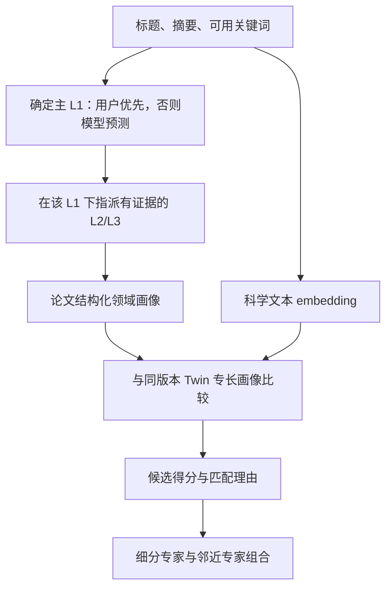

# 从审稿孪生路由目标反推 S4

日期：2026-10-17。本文是设计评估与建议，不替换 S4 v4.2，也不改变已运行实验。

## 1. 用户明确的目标

输入为论文标题、摘要、可用关键词等内容，以及可选的用户一级领域。输出为多级显式分类，再结合内容 embedding 为论文选择匹配的数字孪生审稿人。

- 用户提供 L1 时，最终主分类 L1 以用户为准。
- 用户未提供 L1 时，模型给出最优 L1，再进行下级分类。
- 模型与用户 L1 冲突时，保留用户 L1，在该领域语境下继续判断 L2/L3；模型建议与冲突信息另存。
- 下级分类必须有论文内容依据；没有依据时允许停在父级或 unknown，不能为了满足根节点而编造分类。

这里的“显式分类”指系统输出可读类别/路径，与“作者亲自申报的类别”分开记录来源。用户指定根作为控制条件记录，语义真值由独立标注提供。

## 2. 对当前设计的结论

方向合理，现有证据抽取、归一、层级检查、多来源可靠性和 embedding 对照都可复用。但当前重点是自由 taxonomy 构建，和用户根节点约束下的稳定分类/路由存在偏差；同时还缺少明确的 reviewer scoring 接口。

| 当前事实 | 与目标的关系 | 建议 |
|---|---|---|
| S4_plan.md:51 规定 L1/L2/L3 全部自由归纳，官方目录仅用于独立监督头 | 未实现用户根节点优先的条件分类 | 将用户条件化的主路径指派作为明确推理模式；旧自由树用作离线候选库和无根条件对照 |
| 每模型最多生成 3+9+27 个节点/篇，四路合并与验证 | 适合发现候选，在线成本与类别漂移需要控制 | 离线建库/更新，在线优先指派到冻结节点；不要求每个节点固定三分支 |
| 六板块作为输入 | 可增加信息，但用户目标和外部主 benchmark 均可从标题摘要开始 | 定义 TA 最小输入；TAK 与六板块做分开的增强输入实验 |
| L2 混合任务族/方法族，L3 混合具体问题/技术路线 | 跨 facet 节点可能没有合法父子关系 | 每条路径内部保持语义一致；任务、方法、应用等跨维度标签并列，通过关系连接 |
| 至少两篇、两来源等作为活跃节点门槛 | 保护稳定目录，但可能漏掉新颖细分方向 | 稀有、证据充分的标签保留候选特征；不能因未成为正式目录节点就从画像全部删除 |
| DS/条件 Crowd Layer、粗类监督、结构修复等已有实现 | 是否改善最终路由还未验证 | 作为可消融离线增强；与简单单模型/多数融合在匹配任务上比较，不预先认定全套最优 |
| 当前评价侧重官方粗类 F1、层级结构、稳定性 | 不能充分证明下级分类正确或审稿人匹配有效 | 补充下级独立参照与下游专家适配评价 |
| S6/S8 标记为规划中 | 论文 taxonomy 尚不能直接等同于 Twin 路由 | 明确论文画像、Twin 专长画像、配对得分及候选排序接口 |

对元数据最小路径，分类计算本身不必依赖全文 S3 profile 才能启动；该建议路径作为独立开发实验，生产流程继续遵循 S3 冻结要求。

## 3. 建议的最小完整流程

### 3.1 一级领域的处理

分别保存 `user_l1`、`model_l1`、`effective_l1`、`l1_source` 与冲突信息。若用户类别为自由文本，可增加 canonical mapping；不确定的映射不能自动替换用户原意。用户未提供时，输出模型最优类别及其不确定性，不把未经校准的自信分当正确概率。

用户 L1 作为主路径的硬约束；内容 embedding 仍由原始论文文本计算，不能为了符合 L1 而改写原文。跨域技术信息以辅助 facet 保存。

例如用户选择教育，内容使用因果推断：主路径可以是“教育→教育干预研究→学习效果因果评估”；方法标签另存“因果推断”。若论文实际完全没有教育内容，L1 仍保留教育，下级标记依据不足，保留模型建议的其他领域，不伪造“教育”子类。

### 3.2 分类节点与跨论文一致性

单篇自由生成的字符串不足以稳定匹配。论文与 Twin 必须使用同一 taxonomy 版本、节点 ID、定义、父级、别名与 facet。

建议先用已有候选离线形成领域库；对新论文先召回已有节点再基于原文指派，证据不足的节点不选。确有新方向时生成 candidate；正式节点的创建、合并或换父级放入离线版本更新。允许可变深度、多条有证据路径，避免固定分支数成为输出要求。

路径需要区分 is-a/子领域关系和“使用某方法”等关系。不能把任意方法名、任务名和应用名拼成貌似有三层的分类树。证据定位只能证明引用存在，仍需评估引用是否支持分类。

### 3.3 Twin 侧需要对称画像

每个 Twin 至少具有：支持其专长的证据论文、相同 taxonomy 下的节点及支持度、对应内容向量、可审任务/方法范围和证据来源。行为偏好可以在 S6 另行建模；领域向量本身不足以证明审稿行为已被复制。

对于已有 archetype，用其支持论文和证据构造专长表示。没有可核查专长证据的角色应回退通用组。

### 3.4 先采用可解释的简单混合分数

初始可定义：

\[
s(p,r)=\lambda\,\widetilde{s}_{emb}(p,r)+(1-\lambda)\,s_{tax}(p,r).
\]

`s_emb` 来自论文与审稿人证据论文的相似度聚合；`s_tax` 来自共有节点、祖先关系、细分层级、支持度等。两项先处理尺度；lambda 固定或仅在开发数据选择。细分标签的权重收益作为待测试假设。

用户 L1 决定主路由范围；在范围内排序后，若证据不足回退上一级/通用角色，并披露不确定性。邻近专家通过辅助领域/方法 facet 和 embedding 召回，不因主路径固定而丢失跨领域专长。

初期不必同时引入新图网络、深度排序模型或复杂团队优化。先证明显式层级在同一个 embedding 上提供增益，再决定是否扩大机制。已有多模型融合实验可继续为这一判断提供候选表示与消融。

## 4. 值得借鉴的现有方法

| 来源 | 可借鉴部分 | 与我们任务的关系/边界 |
|---|---|---|
| [TaxoAdapt，ACL 2025](https://aclanthology.org/2025.acl-long.1442/) | 多维分类、迭代层级分类、根据语料分布扩展宽度与深度 | 支持离线建库/更新；不能仅凭该方法证明专家适配更好 |
| [TopicGPT，NAACL 2024](https://aclanthology.org/2024.naacl-long.164/) | 自然语言类别名称与描述、用户约束、可修改主题 | 支持可解释类别及用户控制；具体多层根约束仍需我们定义 |
| 层级多标签分类的通用实现原则 | 先根后子、合法路径、可变深度、多标签、未知类处理 | 根优先需求可直接用条件推理实现；本条是设计原则，不指定未经检索验证的新论文 |
| [OpenReview Expertise](https://github.com/openreview/openreview-expertise) | SPECTER2/SciNCL 的科学表示、审稿人历史论文聚合 | 提供真实可运行的强基线和 scoring 接口 |
| 同一仓库的 MFR | 多个 facet 向量表示同一篇论文的多个方面 | 支持跨域多方面表示；也说明“多方面表示”已有先例 |
| [ACL 2023 matching design](https://2023.aclweb.org/blog/reviewer-assignment/) | 领域、贡献类型等多维匹配与可读匹配理由 | 帮助定义显式特征；多维匹配本身不能作为新颖性主张 |

TaxoAdapt 与 TopicGPT 的机制说明核查自 ACL Anthology 摘要；没有把它们视为已完整复现或用户根约束的现成实现。

## 5. 是否能在“2023 benchmark”比较

这里采用 *A Gold Standard Dataset for the Reviewer Assignment Problem*：2023 年首次公开，2025 年修订并发表于 TMLR。

数据有 58 位研究者、477 个 1–5 分专家自评，以及研究者历史发表论文。它评价的是专家—论文适配。我们必须把 taxonomy 与 embedding 转成每个专家—论文对的数值分数，才能接官方评价脚本。

### 5.1 可直接比较的部分

1. 对投稿候选论文与专家历史论文使用同一冻结分类器/ontology。
2. 聚合专家历史论文的分类和向量，形成专长画像。
3. 输出 `reviewer_id -> paper_id -> similarity_score`。
4. 对官方 `d_20_1` 至 `d_20_10` 的十组画像样本运行方法，接作者 `evaluation_script.py`。

十组 d_20 是历史论文画像的重复采样版本。主脚本调用 `compute_kendall_tau`，实际返回按自评差值加权的归一化错序损失，越低越好，并按 reviewer bootstrap 给区间。辅助 `compute_resolution` 评价 easy/hard 区分能力：easy 为一个评分≥4、另一个≤2；hard 为两个评分都≥4且不相等。

**评价方向：**固定研究者，比较其对不同论文的能力排序。它能检验配对分数的一部分性质，但不提供完整的“固定论文，所有候选人谁最适合”的稠密真值，也没有数字孪生行为或三人团队 gold。

### 5.2 输入与用户根节点协议

官方主协议使用标题摘要；不能默认有用户申报 L1 或关键词。

- 主比较：无用户 L1，模型按预先冻结规则预测，再给下级分类；所有方法只用相同 TA 与同一历史论文画像。显式分类是从 TA 派生的表示，不算新增外部输入。
- 增强输入：关键词或全文只在共同可得子集做单独实验，披露资料来源；不得仅给我们六板块，基线却只有 TA。
- 用户 L1 功能：另设用户根存在/缺失/与模型冲突的产品测试。若使用领域元数据作根，应标记为 metadata-rooted 扩展并给基线同等信息，不能冒充原版官方协议。

S4 的 ICLR 粗类头与该 benchmark 分别记录类别覆盖。冻结 taxonomy 的覆盖范围需报告；跨库未覆盖方向允许父级/unknown 回退。主实验不应把 477 个自评分当作分类、融合或权重调参的免费训练集；如需监督学习，做清晰的开发/留出划分，并按 reviewer 与关联论文处理泄漏。

若用所有待评论文文本参与类别归纳，必须注明 transductive；更清楚的首轮协议是在外部训练/开发语料上建库，冻结后仅指派。现代预训练模型可能见过公共论文，统一披露预训练暴露风险，不将其等同于使用自评标签泄漏。

### 5.3 最小基线与消融

| 组别 | 内容 | 能回答的问题 |
|---|---|---|
| 便宜基线 | TF-IDF；BGE-M3 | 是否优于简单内容匹配 |
| 强科学基线 | SPECTER2、SciNCL、SPECTER2+SciNCL | 是否优于专门科学表示 |
| taxonomy only | 只有共有/层级节点匹配 | 层级分类自身有多少有效信号 |
| embedding + flat labels | 相同 encoder 加扁平显式标签 | 显式标签是否有用 |
| embedding + hierarchy | 相同 encoder 加 L1/L2/L3 路径 | 层级是否进一步有用 |
| 完整融合 | 相同 encoder 加多来源融合后的层级 | 多模型可靠性融合是否值得成本 |

至少先固定相同 encoder，对比“无 taxonomy / 扁平 / 层级”；再比较完整融合与简单生成。主指标为官方加权错序损失，辅助 easy/hard accuracy、unknown 覆盖和 tokens/费用/延迟。比较使用同一 reviewer bootstrap 样本，避免把 477 条观测或衍生 triples 当作独立同分布样本。

## 6. 哪些结论还需另外的证据

| 主张 | 该 benchmark 能否验证 | 还需什么 |
|---|---|---|
| 混合表示改进专家适配排序 | 可以 | 相同输入/画像的官方协议比较 |
| L2/L3 语义准确 | 不能直接 | 独立层级类别参照、证据支持与层级合法性评价 |
| 用户 L1 始终优先且不编造下级 | 不能直接 | 根存在/缺失/冲突、证据不足测试 |
| 选中的 Twin 真有相关专长 | 只能验证专业画像的代理部分 | Twin 支持证据与领域能力任务 |
| Twin 复现真实审稿行为 | 不能 | 独立历史行为/审稿能力评测 |
| 2+1 团队提高有效问题覆盖 | 不能 | 同预算下游审稿评价与团队消融 |

建议把近期可证伪命题收窄为：在相同文本和专家画像条件下，受控的显式层级分类能否为科学 embedding 提供额外的适配排序信号。S4 结构指标服务诊断，下游适配指标决定该模块对最终目标是否值得。

## 7. 本次核查与执行状态

读取当前 S4 计划与 crowd fusion、S6/S8 状态；读取 TaxoAdapt/TopicGPT 官方页面，以及 Gold Standard 官方 `evaluation_script.py` 与 `scripts/scoring.py`。本次未训练模型、调用付费生成、启动 benchmark、修改运行中实验或替换已批准计划。

官方 benchmark：<https://github.com/niharshah/goldstandard-reviewer-paper-match>。

论文：<https://arxiv.org/abs/2303.16750>。
